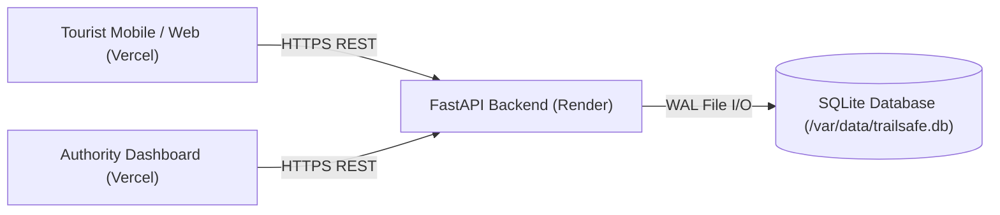

# TrailSafe Production Deployment Guide

This guide details how to deploy **TrailSafe** to production with a public HTTPS frontend and backend, secure CORS configuration, and persistent data storage.

---

## Architecture Overview

| Component | Technology | Recommended Hosting | Description |
| :--- | :--- | :--- | :--- |
| **Frontend** | React 19, TypeScript, Vite, Leaflet | **Vercel** (or Netlify / Cloudflare Pages) | Static single-page application compiled to `/dist` |
| **Backend API** | FastAPI, Uvicorn, Python 3.12 | **Render** (or Railway / Fly.io / AWS App Runner) | Asynchronous REST API service |
| **Database** | SQLite (WAL mode, Foreign Keys) | **Persistent Disk** on PaaS or Server Volume | File-based relational storage |



---

## 1. Backend Deployment (Render)

Render provides managed Web Services for Python with automatic HTTPS and custom domain support.

### Step-by-Step Setup

1. **Create Web Service**:
   - Log in to [Render Dashboard](https://dashboard.render.com/).
   - Click **New +** > **Web Service**.
   - Connect your Git repository containing the TrailSafe codebase.

2. **Configure Service Settings**:
   - **Name**: `trailsafe-backend` (or your preferred name)
   - **Region**: Choose the region closest to your users (e.g., `Singapore` or `Frankfurt`)
   - **Branch**: `main`
   - **Root Directory**: Leave blank (root of repository)
   - **Runtime**: `Python 3`
   - **Build Command**:
     ```bash
     pip install -r backend/requirements.txt
     ```
   - **Start Command**:
     ```bash
     uvicorn app.main:app --app-dir backend --host 0.0.0.0 --port ${PORT:-8000}
     ```
     *(FastAPI can also be started with `python -m app.main` which automatically honors `$PORT` and binds to `0.0.0.0`)*

3. **Configure Environment Variables**:
   In the Render Web Service settings, add the following under **Environment Variables**:

   | Variable Name | Example Value | Description |
   | :--- | :--- | :--- |
   | `PORT` | `10000` | Injected automatically by Render. Server binds to `0.0.0.0:$PORT`. |
   | `CORS_ORIGINS` | `https://trailsafe.vercel.app,https://trailsafe-preview.vercel.app` | Comma-separated list of permitted frontend origins. **Never use wildcard `*`**. |
   | `TRAILSAFE_DB_PATH` | `/var/data/trailsafe.db` | Absolute path to SQLite database (see [Database Persistence](#3-database-persistence--storage)). |
   | `PYTHON_VERSION` | `3.12.0` | Ensures compatible Python runtime. |

4. **Health Check Path**:
   - Set **Health Check Path** to:
     ```
     /api/health
     ```
   - Render uses this path to monitor service readiness during zero-downtime rolling deploys.

5. **Deploy**:
   - Click **Create Web Service**.
   - Note down the assigned public URL (e.g., `https://trailsafe-backend.onrender.com`).

---

## 2. Frontend Deployment (Vercel)

Vercel provides optimized global edge CDN hosting for Vite-based React single-page applications.

### Step-by-Step Setup

1. **Import Project**:
   - Log in to [Vercel Dashboard](https://vercel.com/).
   - Click **Add New...** > **Project**.
   - Select your Git repository.

2. **Configure Project Settings**:
   - **Framework Preset**: `Vite`
   - **Root Directory**: `./` (project root)
   - **Build Command**: `npm run build`
   - **Output Directory**: `dist`
   - **Install Command**: `npm install`

3. **Configure Environment Variables**:
   Under **Environment Variables**, add:

   | Variable Name | Value | Scope | Description |
   | :--- | :--- | :--- | :--- |
   | `VITE_API_BASE_URL` | `https://trailsafe-backend.onrender.com` | Production, Preview, Development | Public URL of your deployed backend service (without trailing slash). |

4. **Deploy**:
   - Click **Deploy**.
   - Vercel builds the bundle (`tsc -b && vite build`) and publishes it to edge nodes worldwide.
   - Note down your Vercel production URL (e.g., `https://trailsafe.vercel.app`).

5. **Sync Backend CORS**:
   - Return to Render and update `CORS_ORIGINS` with your actual Vercel URL:
     ```
     CORS_ORIGINS=https://trailsafe.vercel.app
     ```
   - Render will redeploy or reload the service with the authorized origin.

---

## 3. Database Persistence & Storage

### Understanding SQLite in PaaS Environments

> [!WARNING]
> **Ephemeral Storage Notice**:
> Render's free tier and default standard containers use an **ephemeral disk**. Any file written to the local container disk is wiped when:
> - The service redeploys or restarts.
> - The service spins down due to inactivity (free tier cold sleep).

### Production Solution: Render Persistent Disk

To persist incident history, responder assignments, and audit trails across restarts and deployments:

1. In Render, go to your Web Service > **Disks**.
2. Click **Add Disk**:
   - **Name**: `trailsafe-db-data`
   - **Mount Path**: `/var/data`
   - **Size**: `1 GB` (sufficient for millions of incident records)
3. Set the environment variable:
   ```env
   TRAILSAFE_DB_PATH=/var/data/trailsafe.db
   ```
4. `backend/app/database.py` automatically ensures the parent directory `/var/data` exists and establishes WAL mode (`PRAGMA journal_mode = WAL;`) for high-concurrency read/write operations.

---

## 4. Security & CORS Rules

> [!CAUTION]
> **Never set CORS to wildcard (`*`) in production.**

### Why Wildcard CORS is Prohibited
1. **Security Vulnerability**: A wildcard origin (`*`) allows arbitrary third-party malicious websites to execute cross-origin requests against your API on behalf of your users.
2. **Credential Incompatibility**: Modern browsers reject credentialed requests (`allow_credentials=True`) when `Access-Control-Allow-Origin` is `*`.
3. **Audit Compliance**: TrailSafe enforces strict origin checks. The backend automatically strips trailing slashes, deduplicates origins, and rejects wildcard entries.

### Multiple Origins Configuration
If you have multiple environments (e.g. production, staging, and Vercel preview deployments), separate them with commas in `CORS_ORIGINS`:

```env
CORS_ORIGINS=https://trailsafe.vercel.app,https://trailsafe-preview-abc.vercel.app,https://admin.trailsafe.org
```

Localhost and private LAN IP ranges (192.168.x.x, 10.x.x.x, 172.16-31.x.x) remain permitted by built-in regex for local development and live hardware demonstrations.

---

## 5. Post-Deployment Verification & Smoke Tests

After deploying both frontend and backend, execute these tests to verify full end-to-end functionality:

### 1. Backend Health Check
Verify the backend is live and responding:
```bash
curl -I https://trailsafe-backend.onrender.com/api/health
```
**Expected response**: `HTTP/2 200` with payload:
```json
{"status": "ok", "project": "TrailSafe"}
```

### 2. Verify CORS Preflight Header
Verify preflight requests from your Vercel frontend are accepted:
```bash
curl -X OPTIONS https://trailsafe-backend.onrender.com/api/incidents \
  -H "Origin: https://trailsafe.vercel.app" \
  -H "Access-Control-Request-Method: POST" \
  -H "Access-Control-Request-Headers: Content-Type" \
  -i
```
**Expected response**: `HTTP 200` with `Access-Control-Allow-Origin: https://trailsafe.vercel.app`.

### 3. Verify Baseline Responders & Geofences
```bash
curl https://trailsafe-backend.onrender.com/api/responders
curl https://trailsafe-backend.onrender.com/api/geofences
```
**Expected response**: List of 5 simulated patrol units and 4 geofence polygons in Lucknow.

### 4. End-to-End Application Workflow Test
1. **Open Frontend**: Navigate to `https://trailsafe.vercel.app`.
2. **Authority Dashboard Check**:
   - Verify the Leaflet map loads centered on Lucknow (`26.8467, 80.9462`).
   - Verify incident markers and patrol units (5 simulated responders) appear on the map.
3. **Tourist SOS Trigger**:
   - Switch to **Tourist View** (or open on a mobile browser).
   - Press the **SOS** button.
   - Confirm backend assigns `risk_score: 100` and `severity: CRITICAL`.
4. **Duplicate SOS Prevention**:
   - Press the SOS button again while the first incident is open.
   - Confirm the client displays the active SOS banner and does not generate a duplicate incident.
5. **Incident Response & Resolution**:
   - In Authority Dashboard, select the open SOS incident.
   - Assign an available patrol unit (e.g. *Unit 1 - Hazratganj Patrol*).
   - Confirm responder status updates to `DISPATCHED` on the map.
   - Mark incident as resolved (`RESOLVED`).
   - Confirm responder returns to `AVAILABLE` and incident status updates to resolved.

---

## 6. Local Development Runbook

Local development continues to work seamlessly without changing production configuration:

### Run Backend Locally
```bash
# Activate your virtual environment, then:
uvicorn app.main:app --app-dir backend --host 127.0.0.1 --port 8000 --reload
```

### Run Frontend Locally
```bash
npm install
npm run dev
```

### Run Verification Suite
```bash
# Run backend test suite
python backend/test_features_api.py
python backend/test_server_risk_calculation.py
python backend/test_incidents_api.py

# Run frontend lint and build
npm run lint
npm run build
```
